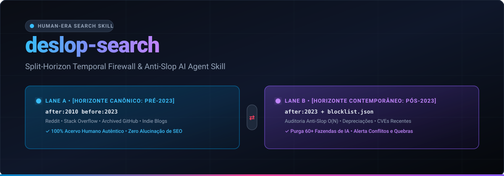
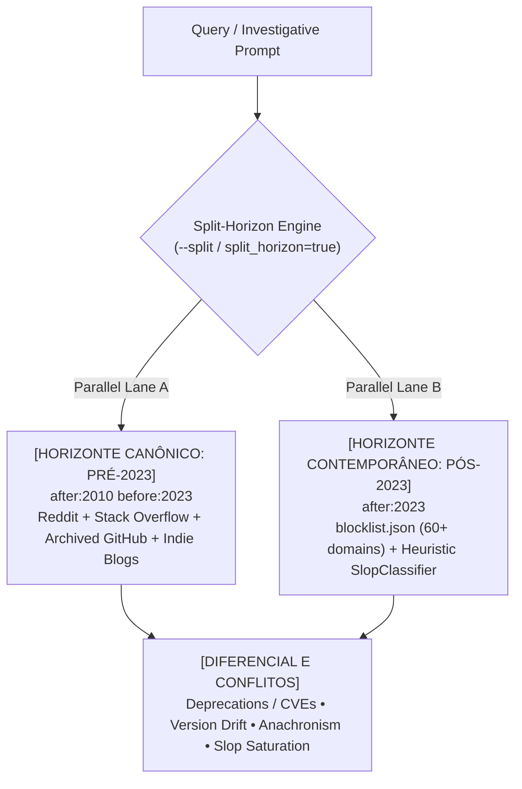

<p align="center">
  
</p>

# `deslop-search` — Split-Horizon Temporal Firewall & Anti-Slop Search Skill

[](./LICENSE)
[](./package.json)
[](./package.json)
[](./pyproject.toml)
[](./SKILL.md)

> **Confront canonical human knowledge with audited contemporary reality.** Strip programmatic SEO farms, machine-translated Q&A clones, and synthetic LLM filler from developer and investigative journalism workflows—via CLI, TypeScript SDK, Python library, and AI Agent Skill.

---

## 1. The Dead Internet Thesis & The `before:2023` Dilemma

On November 30, 2022, the marginal cost of generating plausible-sounding prose collapsed to near zero. Within months, programmatic content mills flooded search indices with millions of synthetic tutorials, hallucinated CLI flags, and SEO-optimized rewrites of Stack Overflow threads.

The viral `before:2023` search heuristic (popularized by Grant Gulovsen) exposed an uncomfortable empirical truth: **slicing off everything indexed after 2022 immediately restores human post-mortems, battle-tested forum threads, and authentic engineering blogs.**

Yet relying on a static `before:2023` cut creates a second trap: **temporal blindness.**
- If an investigative journalist or staff engineer queries only `before:2023`, they miss `CVE-2023-44487` (HTTP/2 Rapid Reset), deprecated stdlib APIs (`ssl.wrap_socket` removed in Python 3.12), regulatory shifts, and post-2023 releases (`React 19`, `Tailwind v4`).
- Conversely, querying the raw post-2023 web exposes RAG pipelines and human researchers to recursive AI hallucinations ("Model Autophagy Disorder") and SEO scraper clones (`copyprogramming`, `codegrepper`, `stackoom`, `qastack`).

---

## 2. The Split-Horizon Thesis (`--split` / `split_horizon`)

Inspired by Split-Horizon DNS, **`deslop-search` v1.1 introduces Dual Temporal Split-Horizon Search**: instead of choosing between *outdated human truth* and *polluted modern results*, the engine fires **two asynchronous search lanes in parallel** and computes a deterministic **Differential & Conflict Synthesis**:



| Horizon Lane | Temporal Bound | Routing & Defense Strategy | Epistemic Role |
|---|---|---|---|
| **Lane A — Canonical Human Archive** | `after:2010 before:2023` | Priority routing to Reddit, Stack Overflow, archived/canonical GitHub repos, HN, Lobste.rs, and indie engineering blogs. | Establishes pre-LLM human consensus, foundational mechanics, and first-principles war stories. |
| **Lane B — Audited Contemporary** | `after:2023` | Open contemporary web guarded by inline `-site:` operator budgeting, 60+ domain `blocklist.json`, and $O(N)$ `SlopClassifier`. | Captures recent breaking changes, CVEs, patches, and news purged of synthetic SEO content farms. |
| **Differential & Conflicts** | Cross-Epoch $\Delta$ | Extracts exclusive technical identifiers/versions per epoch, breaking/deprecation markers, and slop purge ratios. | Alerts humans and AI agents when modern reality invalidates legacy patterns—or when post-2023 SERPs are pure slop. |

---

## 3. Core Architecture

| Module | Implementation | What It Solves |
|---|---|---|
| **1. Temporal Dork Injector** | `src/dorks.ts` / `deslop_search/dorks.py` | Injects `after:2010 before:2023` idempotently, strips zero-width tracking chars, enforces per-engine operator caps (`32` Google / `24` DDG), appends `udm=14` (kills Google AI Overviews), and detects post-2022 subjects (`--smart`). |
| **2. Community Source Router** | `src/router.ts` / `deslop_search/router.py` | Targets high-density human hubs (`qa`, `discussions`, `code`, `blogs`, `forums`) and builds native pre-2023 archive URLs (`hn.algolia.com` `dateEnd=1672531200`, Stack Overflow `created:..2022-12-31`, GitHub `archived:true created:<2023-01-01`). |
| **3. Heuristic Slop Classifier** | `src/classifier.ts` / `deslop_search/classifier.py` | Linear-time $O(N)$ analyzer scoring pages `0.0–1.0` (`AUTHENTIC`, `SUSPICIOUS`, `SLOP`) via EN/PT-BR LLM cliches, `**Bold:**` listicle symmetry, paragraph uniformity ($\text{CV} = \sigma/\mu < 0.18$), sentence burstiness, and a technical-density counter-weight for real code/stack traces. |
| **4. Split-Horizon Engine** | `src/split-horizon.ts` / `deslop_search/split_horizon.py` | Concurrent dual-lane execution (`Promise.all` / `ThreadPoolExecutor`), epoch-exclusive term extraction, and conflict classification (`CONVERGENT`, `DIVERGENT`, `ANACHRONISTIC`, `SLOP_CONTAMINATED`). |

---

## 4. Installation

### Node.js / TypeScript (CLI + SDK)

```bash
git clone https://github.com/your-org/deslop-search.git
cd deslop-search
npm install
npm run build

# Run directly or link globally
npx deslop --help
npm link
```

### Python 3.10+ (Zero External Dependencies)

```bash
pip install .

# Verify CLI
deslop-py --help
python -m deslop_search --help
```

### AI Coding Agents (Claude Code, Antigravity, Cursor, MCP)

- **Skill Discovery:** Copy this repository into `.agents/skills/deslop-search/` or `~/.gemini/config/skills/deslop-search/` ([`SKILL.md`](./SKILL.md) + [`skill.json`](./skill.json)).
- **Tool Calling / MCP:** Import `DESLOP_AGENT_TOOLS`, `executeDeslopTool`, and `executeDeslopToolAsync` from `deslop-search/mcp` (`./dist/mcp-tools.js`). Pass `"split_horizon": true` to `deslop_build_query` or invoke `deslop_split_horizon` directly.

---

## 5. Practical Execution Examples

### 1. CLI — Parallel Live Split-Horizon Search (`--split` / `--split-horizon`)

```bash
# Execute simultaneous Lane A (Pre-2023) + Lane B (Post-2023 Audited) live search
deslop live "http2 rapid reset" --split --limit 3
# Equivalent shorthand subcommand:
deslop split "http2 rapid reset" --limit 3
```

Demarcated terminal output:
```text
========================================================================
[HORIZONTE CANÔNICO: PRÉ-2023]
========================================================================
Dork    : http2 rapid reset after:2010 before:2023 (site:reddit.com OR site:stackoverflow.com OR site:github.com OR site:news.ycombinator.com OR site:lobste.rs ...)
Archive : Kept 3/3 human canonical result(s)
  * [stackoverflow | rank=1 | slop=0] HTTP/2 stream reset handling in nghttp2
    URL: https://stackoverflow.com/questions/...

========================================================================
[HORIZONTE CONTEMPORÂNEO: PÓS-2023]
========================================================================
Dork    : http2 rapid reset after:2023 -site:copyprogramming.com -site:codegrepper.com -site:stackoom.com ...
Audited : Kept 4/5 | Purged 1 (1 blocked domain(s), 1 slop)
  * [hackernews | rank=1 | slop=0] HTTP/2 Rapid Reset Attack (CVE-2023-44487)
    URL: https://cloud.google.com/blog/products/identity-security/how-it-works-the-novel-http2-rapid-reset-ddos-attack

========================================================================
[DIFERENCIAL E CONFLITOS]
========================================================================
Status    : DIVERGENT
Synthesis : Conceptual divergence detected between pre-2023 human consensus (3 hit(s)) and post-2023 audited updates (4 hit(s)); reconcile deprecations/CVEs before adopting legacy recipes.
Post-2023 Exclusive Terms : CVE-2023-44487, HTTP/2
  - [HIGH | deprecation_or_breaking_shift] Post-2023 sources flag breaking shifts, deprecations, or advisories (cve-2023-44487, vulnerability) that may invalidate pre-2023 patterns.
```

### 2. CLI — Dual Split-Horizon Dork Compilation (Zero Network Calls)

```bash
# Node CLI
deslop query "postgres logical replication failover" --split

# Python CLI
python -m deslop_search query "postgres logical replication failover" --split-horizon
```

### 3. CLI — Single-Lane Dork, Community Routes & Slop Classifier

```bash
# Standard human-classic dork + Google udm=14 clean Web URL
deslop query "postgres vacuum freeze wraparound" --profile qa

# Inspect suspected SEO slop page
deslop classify \
  --title "[Updated 2026] Ultimate Guide to Kubernetes" \
  --url "https://copyprogramming.com/howto/k8s-guide" \
  --text "In today's fast-paced digital landscape, Kubernetes is a game-changer..." \
  --json
```

### 4. TypeScript SDK (Split-Horizon + MCP Agent Integration)

```typescript
import { DeslopSearch, deslopSplitHorizon } from "deslop-search";
import { executeDeslopToolAsync } from "deslop-search/mcp";

// 1. Compile dual-lane Split-Horizon query plan
const plan = deslopSplitHorizon("python ssl wrap_socket");
console.log(plan.formattedReport);

// 2. Run parallel live Split-Horizon search
const engine = new DeslopSearch();
const liveReport = await engine.liveSplitHorizonSearch("sqlite wal checkpoint", {
  cutoffYear: 2023,
  limitPerSource: 4
});
console.log(liveReport.differential.status, liveReport.differential.conflictSignals);

// 3. Invoke via MCP / Agent tool-calling contract
const agentResult = await executeDeslopToolAsync("deslop_split_horizon", {
  query: "http2 rapid reset",
  split_horizon: true,
  live: true
});
```

### 5. Python SDK (Threaded Parallel Split-Horizon)

```python
from deslop_search import DeslopSearch, deslop_split_horizon

# 1. Dual query plan
plan = deslop_split_horizon("linux io_uring sqpoll")
print(plan.formatted_report)

# 2. Parallel ThreadPoolExecutor live comparison
engine = DeslopSearch()
report = engine.live_split_horizon_search("http2 rapid reset", limit_per_source=3)
print(report.differential.status)
print(report.formatted_report)
```

---

## 6. Repository Structure

```text
deslop-search/
├── SKILL.md                        # Agent Skill operational specification
├── skill.json                      # Universal plugin & MCP tool-calling manifest (split_horizon)
├── package.json                    # Node/TS package (v1.1.0) & `deslop` CLI binary
├── pyproject.toml                  # Zero-dependency Python package & `deslop-py` CLI
├── data/
│   ├── blocklist.json              # 60+ scraper clones, translation mills & AI farms
│   ├── sources.json                # Curated human forums, Q&A networks & indie blogs
│   └── slop-lexicon.json           # EN + PT-BR heuristic weights & regex signatures
├── src/
│   ├── dorks.ts                    # Temporal Dork Engine & operator budget guard
│   ├── router.ts                   # Community Source Router & native archive URLs
│   ├── classifier.ts               # O(N) Heuristic Slop Classifier
│   ├── split-horizon.ts            # Split-Horizon planner, formatter & conflict analyzer
│   ├── pipeline.ts                 # Parallel orchestrator & live archive fetchers
│   ├── mcp-tools.ts                # MCP / Agent sync & async tool dispatchers
│   └── cli.ts                      # Node CLI (`--split` / `--split-horizon`)
├── python/deslop_search/           # Full Python 3.10+ parity (`split_horizon.py`, `ThreadPoolExecutor`)
└── tests/                          # Vitest (TS) & unittest/pytest (Python) suites
```

## Verification & Quality Gates

```bash
npm run verify
```

## License

Released under the [MIT License](./LICENSE).
